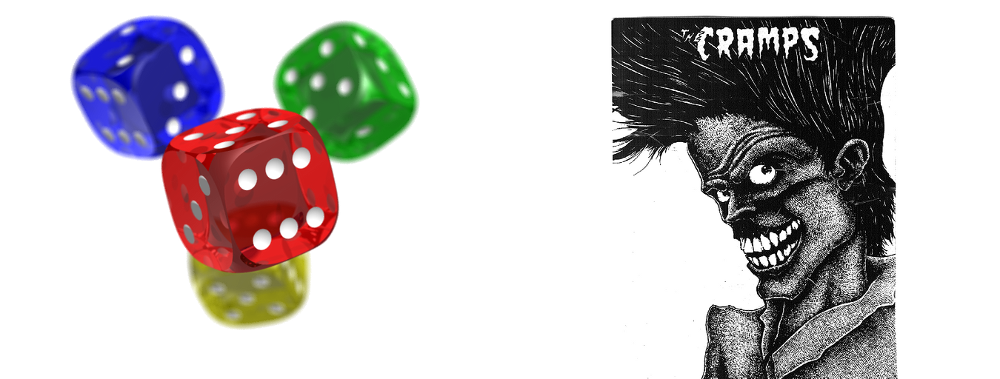
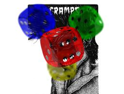
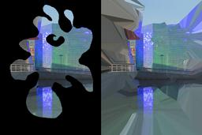

libvips 8.6 is done! Though it's a bit
late. This post summarizes what's new -- check the
[ChangeLog](https://github.com/libvips/libvips/blob/master/ChangeLog)
if you need more details.

## New operators

There are five new operators. The largest is [`composite2`](
/API/current/method.Image.composite2.html): this will composite a pair
of transparent images together using PDF-style blending modes.
For example, given the standard libtiff and libpng demo images:

[](/assets/images/pngtiff.png)

Running:

```
$ vips composite2 cramps.png png_demo1.png x.png over
```

Gives:

[](/assets/images/composite.png)

`over` is probably the most useful, but `composite2` supports all the [PDF blend
modes](/API/current/enum.BlendMode.html).

`composite2` joins a pair of images, but you can join a whole array of images
using an array of blend modes in a single operation with [`composite`](
/API/current/type_func.Image.composite.html). Options let you control the
compositing space and premultiplication handling.

[`fill_nearest`](/API/current/method.Image.fill_nearest.html) replaces every
zero pixel in an image with the nearest non-zero pixel. For example:

[](/assets/images/fill-nearest.png)

The zero pixels on the left have all been replaced. It's reasonably quick
(about a second for that example on this old laptop) and doesn't need that much
memory. It's handy for things like cell counting, where you want to assign cell
pixels to the nearest nucleus.

[`find_trim`](/API/current/method.Image.find_trim.html) searches an image in
from the edges and returns the bounding box of the non-background pixels. It's
useful for automatically trimming away the edges from scanned images.

[`gravity`](/API/current/method.Image.gravity.html) places an image within a
larger canvas, positioning the image according to a compass direction. It's
just [`embed`](/API/current/method.Image.embed.html) with a convenient
interface.

[`thumbnail_image`](/API/current/method.Image.thumbnail_image.html) lets you
thumbnail any image source. It can be useful if you need to do something to
an image before making a thumbnail.

## New features

There are a few new options for existing operations.

* A [`FORCE`](/API/current/enum.Size.html#force) resize mode lets
  you break the image aspect ratio in resizing.

* [`thumbnail`](/API/current/ctor.Image.thumbnail.html) and
  [`vipsthumbnail`](/API/current/using-vipsthumbnail.html) have an
  option for rendering intent, credit to kleisauke.

* [`text`](/API/current/ctor.Image.text.html)
  can autofit text to a box. You give the size of the box to fill,
  and it'll automatically search for a DPI that just fills that area.
  Credit to gargsms.

* [`VIPS_COMBINE_MIN`](/API/current/enum.Combine.html#min) is a new
  combining mode for [`compass`](/API/current/method.Image.compass.html),
  handy for estimating gradients.

* [`hist_find_indexed`](/API/current/method.Image.hist_find_indexed.html)
  now has a `combine` parameter. This makes it possible to quickly find the
  bounding boxes of a large number of objects, for example.

* [`affine`](/API/current/method.Image.affine.html) and [`similarity`](
  /API/current/method.Image.similarity.html) have a `background` parameter.
  Previously, they always used 0 for new pixels and you had to composite on
  something else somehow.

* The nasty jaggies on the edges of affine output have been fixed, credit to
  chregu.

## Image format improvements

As usual, the image load and save operations have had a large number of
improvements:

* The FITS loader supports images with leading non-image HDUs, credit to
  benepo.

* All savers support a `page_height` option for multipage save.

* [`tiffsave_buffer`](/API/current/method.Image.tiffsave_buffer.html) supports
  for pyramid save, credit to bubba.

* [`svgload`](/API/current/ctor.Image.svgload.html) handles very large output
  gracefully, and handles missing width and height, credit to lovell.

* The GIF loader adds `gif-delay`, `gif-comment` and `gif-loop` metadata.

* The GIF loader knows about dispose handling, so it can correctly load complex
  animated GIFs, credit to chregu.

## Changes 

There have been a few changes to existing features.

* The built-in Python bindings for vips7 and vips8 are now deprecated and are
  disabled by default. They are still there and still work, but we now 
  strongly recommend the new `pyvips` binding in pip. 

* The Python part of the libvips test suite has been removed and is now in
  `pyvips`.

* [`conv`](/API/current/method.Image.conv.html), [`compass`](
  /API/current/method.Image.compass.html), [`convsep`](
  /API/current/method.Image.convsep.html) default to `FLOAT`
  precision. This prevents unexpected behaviour in a few common cases.

* The `centre` option for [`resize`](/API/current/method.Image.resize.html)
  is deprecated -- it's now always on.

## Fixes and small improvements

Finally there are a range of smaller improvements:

* New C API:
  [`vips_image_new_from_image()`](
  /API/current/ctor.Image.new_from_image.html)
  and
  [`vips_image_new_from_image1()`](
  /API/current/ctor.Image.new_from_image1.html)
  make a constant image. This has been added to all the language bindings too.

* Better prefix guessing on Windows, credit to tumagonx.

* libvips now sets file create time on Windows, credit to dlong500.

* The `disc` load property has been renamed as `memory` and defaults off.

* libvips has much better gobject-introspection annotations, credit to astavale.

* [`vips_image_write()`](/API/current/method.Image.write.html) severs all links
  between images, when it can. This fixes  a range of annoying problems in large
  programs. Credit to warren and nakilon.

* The vector path for convolution is more accurate and can handle larger masks.

* Linear and cubic kernels for reduce are much higher quality.

* Setting the EXIF data block automatically sets the derived image tags, credit
  to monostefan.

Plus many even smaller bug fixes and improvements. As usual, the 
[ChangeLog](https://github.com/libvips/libvips/blob/master/ChangeLog)
has more details, if you're interested.
