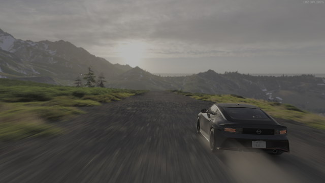

Title: Using > Processing CICP images

[CICP is a relatively new](https://en.wikipedia.org/wiki/Coding-independent_code_points)
way of tagging an image with information about how colour values should be
displayed. It serves roughly the same purpose as an ICC profile, but is
very small, simple, and is designed for HDR.

libvips supports loading and saving images with CICP tags from AVIF, JXL,
and PNG images, it supports loading and saving these images to UltraHDR
formats like JPG with automatic conversion of tags, and it supports save to
ICC-only formats with automatic profile generation. libvips also supports
generating and modifying CICP tags programmatically, including support for
computing some image properties, such as target illumination.

As with other colour tagging systems, like ICC and UtraHDR, there are two main
paths for CICP images. You can leave them as 16-bit unsigned integer with
CICP tags and rely on automatic conversion by savers, or you can convert
them to full HDR images in scRGB space and do you own colour handling.
Doing your own handling will usually be slower, but give more control.

## Native numeric format with CICP tagging

CICP images are 16-bit unsigned integers, with extra metadata for colour
interpretation.

### Load

Images are left in native CICP format by loaders.

For example, here's a CICP HDR PNG image:



This will probably not display correctly in your browser since HDR PNG
images are not very common! Most browsers will just display it as a regular
16-bit PNG and it'll look extremely dark.

You can check the tags to see how it works:

```
$ vipsheader -a cicp-car-small.png
cicp-car-small.png: 640x360 ushort, 3 bands, rgb16, pngload
width: 640
height: 360
bands: 3
format: ushort
coding: none
interpretation: rgb16
xoffset: 0
yoffset: 0
xres: 2.83398
yres: 2.83398
filename: cicp-car-small.png
vips-loader: pngload
icc-profile-data: 4344 bytes of binary data
cicp-colour-primaries: 9
cicp-transfer-characteristics: 16
cicp-matrix-coefficients: 0
cicp-full-range-flag: 1
clli-max-content-light-level: 769
clli-max-frame-average-light-level: 75
exif-data: 180 bytes of binary data
resolution-unit: in
exif-ifd0-Orientation: 1 (Top-left, Short, 1 components, 2 bytes)
exif-ifd0-XResolution: 71983/1000 (71.983, Rational, 1 components, 8 bytes)
exif-ifd0-YResolution: 71983/1000 (71.983, Rational, 1 components, 8 bytes)
exif-ifd0-ResolutionUnit: 2 (Inch, Short, 1 components, 2 bytes)
exif-ifd0-YCbCrPositioning: 1 (Centred, Short, 1 components, 2 bytes)
exif-ifd2-ExifVersion: Exif Version 2.1 (Exif Version 2.1, Undefined, 4 components, 4 bytes)
exif-ifd2-ComponentsConfiguration: Y Cb Cr - (Y Cb Cr -, Undefined, 4 components, 4 bytes)
exif-ifd2-FlashpixVersion: FlashPix Version 1.0 (FlashPix Version 1.0, Undefined, 4 components, 4 bytes)
exif-ifd2-ColorSpace: 65535 (Uncalibrated, Short, 1 components, 2 bytes)
exif-ifd2-PixelXDimension: 640 (640, Long, 1 components, 4 bytes)
exif-ifd2-PixelYDimension: 360 (360, Long, 1 components, 4 bytes)
orientation: 1
xmp-data: 563 bytes of binary data
png-comment-1-Software: HDRFrame
png-comment-2-HDRFrame.CaptureMode: window
png-comment-3-HDRFrame.SourceBackend: wgc
png-comment-4-HDRFrame.SourceHDR: true
bits-per-sample: 16
```

As well as the four pieces of CICP metadata, two extra tags give the peak and
average luminance for the image. These help displays map general image
pixel values to values appropriate for this specific display.

### Save

When you save an image like this in another format, the saver will attempt to
generate the best image it can automatically.

For example:

```
$ vips copy cicp-car-small.png uhdr-car-small.jpg
$ vipsheader -a uhdr-car-small.jpg
uhdr-car-small.jpg: 640x360 uchar, 3 bands, srgb, uhdrload
width: 640
height: 360
bands: 3
format: uchar
coding: none
interpretation: srgb
xoffset: 0
yoffset: 0
xres: 2.83398
yres: 2.83398
filename: uhdr-car-small.jpg
vips-loader: uhdrload
exif-data: 186 bytes of binary data
resolution-unit: in
exif-ifd0-Orientation: 1 (Top-left, Short, 1 components, 2 bytes)
exif-ifd0-XResolution: 71983/1000 (71.983, Rational, 1 components, 8 bytes)
exif-ifd0-YResolution: 71983/1000 (71.983, Rational, 1 components, 8 bytes)
exif-ifd0-ResolutionUnit: 2 (Inch, Short, 1 components, 2 bytes)
exif-ifd0-YCbCrPositioning: 1 (Centred, Short, 1 components, 2 bytes)
exif-ifd2-ExifVersion: Exif Version 2.1 (Exif Version 2.1, Undefined, 4 components, 4 bytes)
exif-ifd2-ComponentsConfiguration: Y Cb Cr - (Y Cb Cr -, Undefined, 4 components, 4 bytes)
exif-ifd2-FlashpixVersion: FlashPix Version 1.0 (FlashPix Version 1.0, Undefined, 4 components, 4 bytes)
exif-ifd2-ColorSpace: 65535 (Uncalibrated, Short, 1 components, 2 bytes)
exif-ifd2-PixelXDimension: 640 (640, Long, 1 components, 4 bytes)
exif-ifd2-PixelYDimension: 360 (360, Long, 1 components, 4 bytes)
orientation: 1
icc-profile-data: 600 bytes of binary data
gainmap-data: 3714 bytes of binary data
gainmap-max-content-boost: 49.2611 49.2611 49.2611
gainmap-min-content-boost: 1 1 1
gainmap-gamma: 1 1 1
gainmap-offset-sdr: 0 0 0
gainmap-offset-hdr: 0 0 0
gainmap-hdr-capacity-min: 1
gainmap-hdr-capacity-max: 49.2611
gainmap-use-base-cg: 1
gainmap-scale-factor: 2
```

The JPEG saver has seen the CICP tags and generated an UltraHDR image
automatically using libultrahdr. Additionally, it has used the CICP tags to
make a synthetic ICC profile which should preserve CICP colour information.

This might now display as HDR, depending on your screen and browser:


You can also convert to AVIF, of course. Since AVIF supports CICP, this is
much simpler.

```
$ vips copy cicp-car-small.png cicp-car-small.avif
```


Again, the appearance will depend on your browser and display. On SDR
displays, these two versions of the original probably won't match well,
since the UltraHDR image has been tonemapped, whereas the AVIF will display
the SDR component of the CICP data.

### High-level libvips operations

The [ctor@Image.thumbnail] operation knows about CICP tags and will use them
automatically for colour processing with the `linear` and `output-profile`
options.

### À la carte processing

You can also take over colour processing yourself by converting a native CICP
image to scRGB using [method@Image.CICP2scRGB].

For example:

```
$ vips CICP2scRGB cicp-car-small.png x.v
$ vipsheader -a x.v
x.v: 640x360 float, 3 bands, scrgb, pngload
width: 640
height: 360
bands: 3
format: float
coding: none
interpretation: scrgb
xoffset: 0
yoffset: 0
xres: 2.83398
yres: 2.83398
filename: x.v
vips-loader: pngload
icc-profile-data: 4344 bytes of binary data
cicp-colour-primaries: 9
cicp-transfer-characteristics: 16
cicp-matrix-coefficients: 0
cicp-full-range-flag: 1
clli-max-content-light-level: 769
clli-max-frame-average-light-level: 75
xmp-data: 563 bytes of binary data
png-comment-1-Software: HDRFrame
png-comment-2-HDRFrame.CaptureMode: window
png-comment-3-HDRFrame.SourceBackend: wgc
png-comment-4-HDRFrame.SourceHDR: true
bits-per-sample: 16
vips-sequential: 1
exif-data: 186 bytes of binary data
resolution-unit: in
exif-ifd0-Orientation: 1 (Top-left, Short, 1 components, 2 bytes)
exif-ifd0-XResolution: 71983/1000 (71.983, Rational, 1 components, 8 bytes)
exif-ifd0-YResolution: 71983/1000 (71.983, Rational, 1 components, 8 bytes)
exif-ifd0-ResolutionUnit: 2 (Inch, Short, 1 components, 2 bytes)
exif-ifd0-YCbCrPositioning: 1 (Centred, Short, 1 components, 2 bytes)
exif-ifd2-ExifVersion: Exif Version 2.1 (Exif Version 2.1, Undefined, 4 components, 4 bytes)
exif-ifd2-ComponentsConfiguration: Y Cb Cr - (Y Cb Cr -, Undefined, 4 components, 4 bytes)
exif-ifd2-FlashpixVersion: FlashPix Version 1.0 (FlashPix Version 1.0, Undefined, 4 components, 4 bytes)
exif-ifd2-ColorSpace: 65535 (Uncalibrated, Short, 1 components, 2 bytes)
exif-ifd2-PixelXDimension: 640 (640, Long, 1 components, 4 bytes)
exif-ifd2-PixelYDimension: 360 (360, Long, 1 components, 4 bytes)
orientation: 1
$ vips max x.v
9.637010
$ vips min x.v
0.000118
```

So the image has been converted to linear float, with the range 0-1 for
black to paper white. Values above 1.0 (the maximum for this image is 9.77,
for example) represent HDR pixels.

The ICC profile and the CICP metadata are untouched. If you convert back the
other way with [method@Image.scRGB2CICP], this metadata is used to generate the
inverse transform.

You can use the libvips metadata API ([method@Image.get_double] and friends)
to get and set the various HDR fields and change the presentation.

You can use [method@Image.percent_lum] to compute new values for
`clli-max-content-light-level` and `clli-max-frame-average-light-level`
efficiently.

